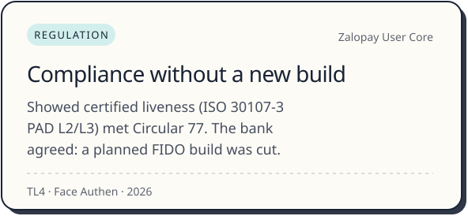
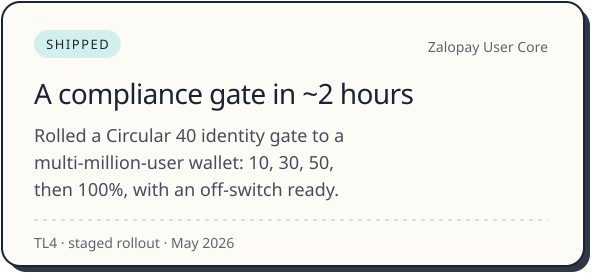
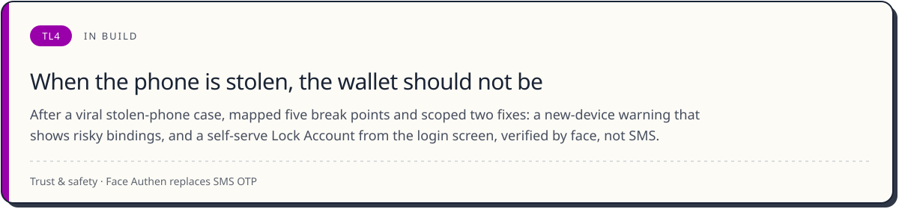
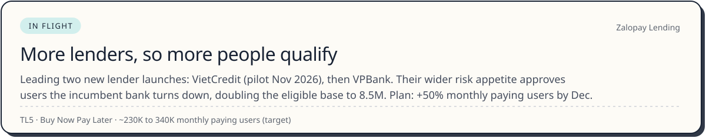
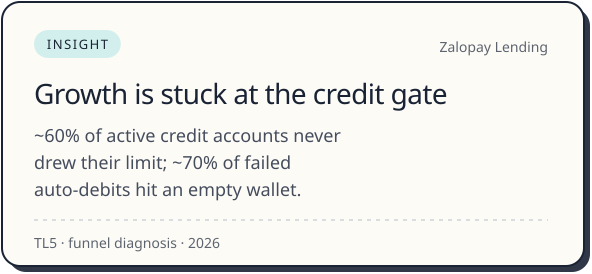
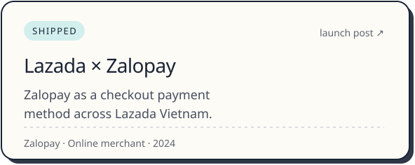
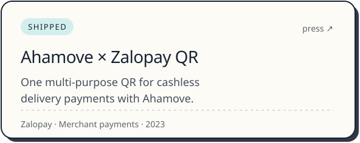

  <picture><source media="(prefers-color-scheme: dark)" srcset="./assets/hero-dark.svg" /></picture>

 

<picture><source media="(prefers-color-scheme: dark)" srcset="./assets/recognition-dark.svg" /></picture>

<picture><source media="(prefers-color-scheme: dark)" srcset="./assets/stage-dark.svg" /></picture>

## Identity and User Core

TL3 to TL4 on the line: the 12-person team I led keeps logins, identity and accounts safe for millions of users.

 

<picture><source media="(prefers-color-scheme: dark)" srcset="./assets/card-vneid-dark.svg" /></picture>

<table>
  <tr>
    <td width="50%"><picture><source media="(prefers-color-scheme: dark)" srcset="./assets/card-c77-dark.svg" /></picture></td>
    <td width="50%"><picture><source media="(prefers-color-scheme: dark)" srcset="./assets/card-gate-dark.svg" /></picture></td>
  </tr>
</table>

<picture><source media="(prefers-color-scheme: dark)" srcset="./assets/card-lock-dark.svg" /></picture>

## Credit: Buy Now Pay Later

TL5, where I am now: growing BNPL with banks and lenders across Zalopay checkout.

 

<picture><source media="(prefers-color-scheme: dark)" srcset="./assets/card-mpu-dark.svg" /></picture>

<table>
  <tr>
    <td width="50%"><picture><source media="(prefers-color-scheme: dark)" srcset="./assets/card-idle-dark.svg" /></picture></td>
    <td width="50%"><picture><source media="(prefers-color-scheme: dark)" srcset="./assets/card-stepup-dark.svg" /></picture></td>
  </tr>
</table>

## Merchants and payments

Public launch posts and press. Click a card to open the source.

 

<a href="https://www.linkedin.com/posts/zalopay_zalopay-apple-appstore-activity-7285511140061720578-ayP3"><picture><source media="(prefers-color-scheme: dark)" srcset="./assets/card-apple-dark.svg" /></picture></a>

<table>
  <tr>
    <td width="50%"><a href="https://www.linkedin.com/posts/zalopay_zalopay-lazada-digitalpayments-activity-7209474637741662208-zX4O"><picture><source media="(prefers-color-scheme: dark)" srcset="./assets/card-lazada-dark.svg" /></picture></a></td>
    <td width="50%"><a href="https://cafef.vn/ahamove-ap-dung-zalopay-qr-da-nang-trong-thanh-toan-khong-tien-mat-188231227175858974.chn"><picture><source media="(prefers-color-scheme: dark)" srcset="./assets/card-ahamove-dark.svg" /></picture></a></td>
  </tr>
</table>

## I also build the tools

When a tool I need does not exist, I build it. The rule I keep: the agent proposes, a person approves.

 

<picture><source media="(prefers-color-scheme: dark)" srcset="./assets/card-codereader-dark.svg" /></picture>

<table>
  <tr>
    <td width="50%"><a href="https://github.com/thai-max-nguyen/claw-a-thon-demo-agent-mvp"><picture><source media="(prefers-color-scheme: dark)" srcset="./assets/card-growth-dark.svg" /></picture></a></td>
    <td width="50%"><a href="https://thai-max-nguyen.github.io/Gmat-Math-Trainer/"><picture><source media="(prefers-color-scheme: dark)" srcset="./assets/card-gmat-dark.svg" /></picture></a></td>
  </tr>
</table>

## Let's talk

Happy to talk payments, digital identity, credit and AI tools for product teams, ideally over kopi-C kosong.

[Email](mailto:thaiquang.nguyenle@gmail.com) · [LinkedIn](https://www.linkedin.com/in/thai-max-nguyen-6957b2213)
