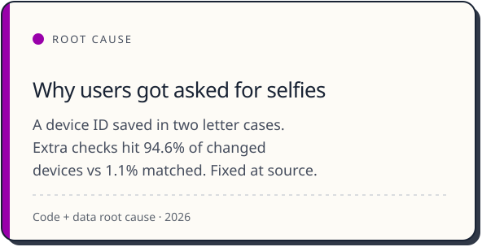
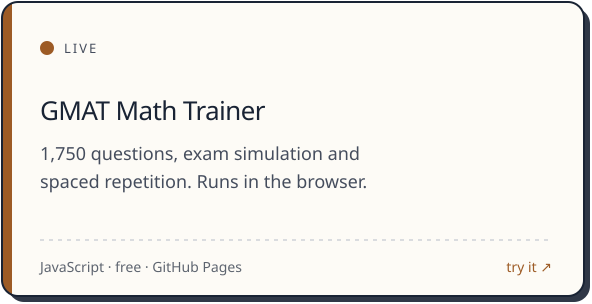

  <picture><source media="(prefers-color-scheme: dark)" srcset="./assets/hero-dark.svg" /></picture>

 Zalopay lives inside Zalo, the chat app on most phones in Vietnam.

<b><a href="https://thai-max-nguyen.github.io">Portfolio: thai-max-nguyen.github.io</a></b>

<picture><source media="(prefers-color-scheme: dark)" srcset="./assets/recognition-dark.svg" /></picture>

<picture><source media="(prefers-color-scheme: dark)" srcset="./assets/stage-dark.svg" /></picture>

## Merchants and payments

Where I started at Zalopay. Click a card for the public launch post.

 

<a href="https://www.linkedin.com/posts/zalopay_zalopay-apple-appstore-activity-7285511140061720578-ayP3"><picture><source media="(prefers-color-scheme: dark)" srcset="./assets/card-apple-dark.svg" /></picture></a>

<table>
  <tr>
    <td width="50%"><a href="https://www.linkedin.com/posts/zalopay_zalopay-lazada-digitalpayments-activity-7209474637741662208-zX4O"><picture><source media="(prefers-color-scheme: dark)" srcset="./assets/card-vietqr-dark.svg" /></picture></a></td>
    <td width="50%"><picture><source media="(prefers-color-scheme: dark)" srcset="./assets/card-xanhsm-dark.svg" /></picture></td>
  </tr>
</table>

## Identity and User Core

The 12-person team I led keeps logins, identity and accounts safe for millions of users.

 

<a href="https://vnexpress.net/nguoi-dung-zalopay-co-the-xac-thuc-dien-tu-qua-vneid-4872599.html"><picture><source media="(prefers-color-scheme: dark)" srcset="./assets/card-vneid-dark.svg" /></picture></a>

<picture><source media="(prefers-color-scheme: dark)" srcset="./assets/card-stepup-dark.svg" /></picture>

## Buy Now Pay Later

Where I am now: the whole journey, across lenders.

 

<picture><source media="(prefers-color-scheme: dark)" srcset="./assets/card-bnpl-dark.svg" /></picture>

## Tools and standards I built

Small systems that make the team's work repeatable. They gather and draft; people make the calls.

 

<picture><source media="(prefers-color-scheme: dark)" srcset="./assets/card-codereader-dark.svg" /></picture>

<table>
  <tr>
    <td width="50%"><picture><source media="(prefers-color-scheme: dark)" srcset="./assets/card-cstickets-dark.svg" /></picture></td>
    <td width="50%"><picture><source media="(prefers-color-scheme: dark)" srcset="./assets/card-prd-dark.svg" /></picture></td>
  </tr>
  <tr>
    <td width="50%"><a href="https://github.com/thai-max-nguyen/claw-a-thon-demo-agent-mvp"><picture><source media="(prefers-color-scheme: dark)" srcset="./assets/card-growth-dark.svg" /></picture></a></td>
    <td width="50%"><a href="https://thai-max-nguyen.github.io/Gmat-Math-Trainer/"><picture><source media="(prefers-color-scheme: dark)" srcset="./assets/card-gmat-dark.svg" /></picture></a></td>
  </tr>
</table>

## Let's talk

Happy to talk payments, digital identity, Buy Now Pay Later and AI tools for product teams, ideally over kopi-C kosong.

[Portfolio](https://thai-max-nguyen.github.io) · [Email](mailto:thaiquang.nguyenle@gmail.com) · [LinkedIn](https://www.linkedin.com/in/thai-max-nguyen-6957b2213)
