

  <picture><source media="(prefers-color-scheme: dark)" srcset="./assets/hero-dark.svg" /></picture>

<a href="https://thai-max-nguyen.github.io">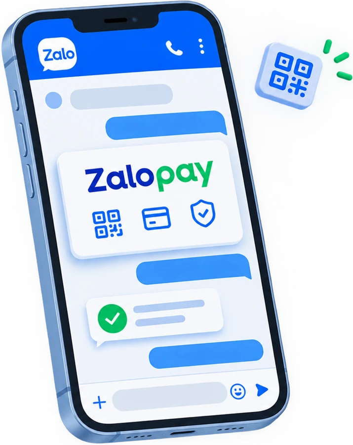</a> Zalopay lives inside Zalo, the chat app on most phones in Vietnam.

<b><a href="https://thai-max-nguyen.github.io">Portfolio: thai-max-nguyen.github.io</a></b>

<picture><source media="(prefers-color-scheme: dark)" srcset="./assets/recognition-dark.svg" /></picture>

## Buy Now Pay Later

Where I am now. A bank or finance company lends, Zalopay runs the product.

<a href="https://vneconomy.vn/zalopay-hop-tac-cung-ngan-hang-cimb-viet-nam-ra-mat-san-pham-tai-khoan-tra-sau.htm"><picture><source media="(prefers-color-scheme: dark)" srcset="./assets/card-bnpl-dark.svg" /></picture></a>

## Identity

Login and identity for millions of Zalopay users. The team I led.

<a href="https://vnexpress.net/nguoi-dung-zalopay-co-the-xac-thuc-dien-tu-qua-vneid-4872599.html"><picture><source media="(prefers-color-scheme: dark)" srcset="./assets/card-vneid-dark.svg" />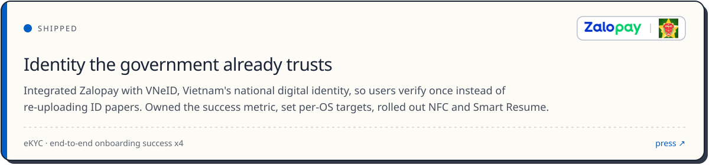</picture></a>

<picture><source media="(prefers-color-scheme: dark)" srcset="./assets/card-autocapture-dark.svg" />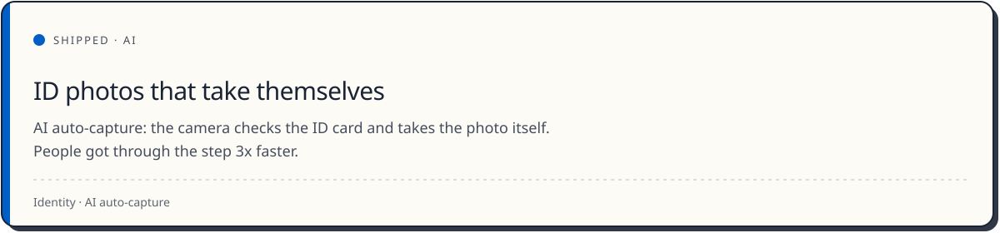</picture>

<picture><source media="(prefers-color-scheme: dark)" srcset="./assets/stage-dark.svg" />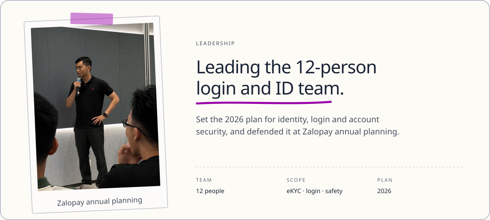</picture>

## Merchant payments

Where I started at Zalopay in 2023.

<a href="https://baodautu.vn/thanh-toan-duoc-bang-zalopay-tren-app-store-va-cac-dich-vu-khac-cua-apple-d240993.html"><picture><source media="(prefers-color-scheme: dark)" srcset="./assets/card-apple-dark.svg" />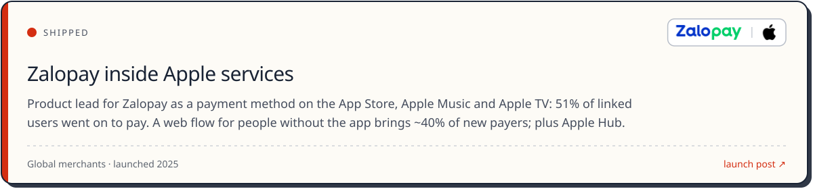</picture></a>

<a href="https://www.brandsvietnam.com/congdong/topic/zalopay-vinh-danh-giai-sao-khue-2025-dot-pha-thanh-toan-khong-tien-mat-trong-logistics"><picture><source media="(prefers-color-scheme: dark)" srcset="./assets/card-vietqr-dark.svg" />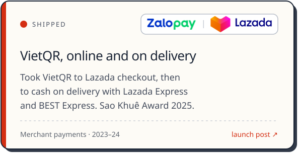</picture></a><a href="https://www.greensm.com/vn-vi/news/thanh-toan-zalopay-nhan-ngay-uu-dai-toi-80k-di-xanh-sm-toi-shopping-season-2024-mua-sam"><picture><source media="(prefers-color-scheme: dark)" srcset="./assets/card-xanhsm-dark.svg" />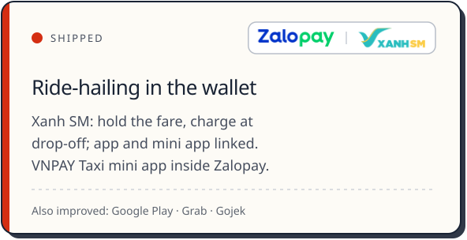</picture></a>

## Lazada

Two years on bank partnerships and card products.

<a href="https://vnexpress.net/the-dong-thuong-hieu-dau-tien-hoan-toi-50-khi-mua-sam-online-4555454.html"><picture><source media="(prefers-color-scheme: dark)" srcset="./assets/card-lazcard-dark.svg" />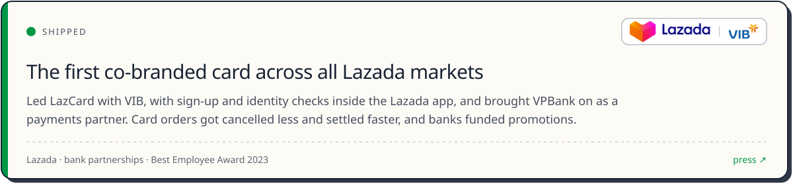</picture></a>

## Scaling the team with AI

Small systems that make the team's work repeatable. They collect information and write drafts. A person makes every decision.

<picture><source media="(prefers-color-scheme: dark)" srcset="./assets/card-analysis-dark.svg" /></picture><picture><source media="(prefers-color-scheme: dark)" srcset="./assets/card-codereader-dark.svg" /></picture>

<picture><source media="(prefers-color-scheme: dark)" srcset="./assets/card-prd-dark.svg" /></picture><a href="https://github.com/thai-max-nguyen/claw-a-thon-demo-agent-mvp"><picture><source media="(prefers-color-scheme: dark)" srcset="./assets/card-growth-dark.svg" /></picture></a>

<picture><source media="(prefers-color-scheme: dark)" srcset="./assets/card-cstickets-dark.svg" />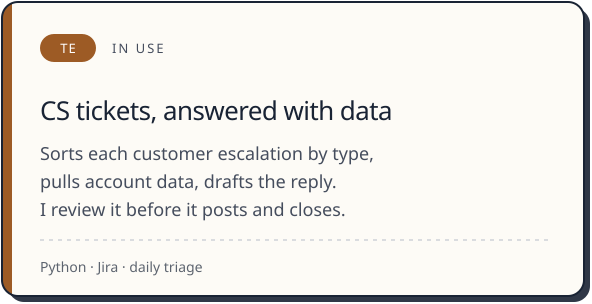</picture>

## Next stop: Singapore

I have shipped regulated payment, identity and lending products in Vietnam. I want to do that work at regional scale from Singapore.

I am looking for a product role in Singapore in fintech or tech, where I can own a lending, payments or growth product end to end. I have launched regulated products, worked with banks and global platforms, and I check the data myself. The fastest way to reach me is email. I reply within a day.

[Portfolio](https://thai-max-nguyen.github.io) · [Email](mailto:thaiquang.nguyenle@gmail.com) · [LinkedIn](https://www.linkedin.com/in/thai-max-nguyen-6957b2213)
